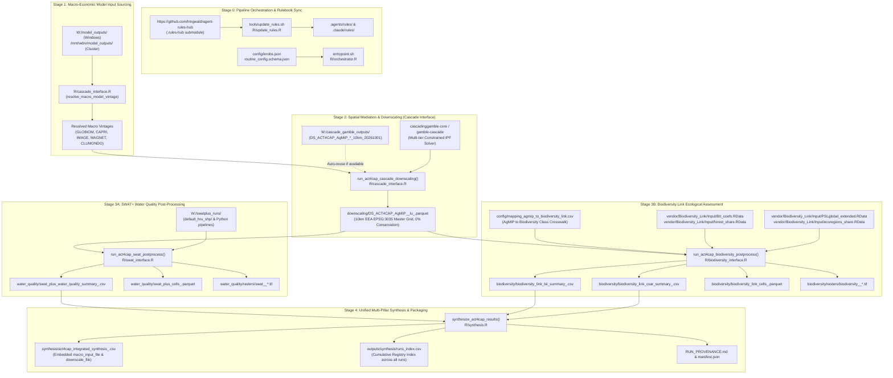

# Act4Cap Pipeline Data & Script Lineage Document (`PIPELINE_LINEAGE.md`)

This document provides the formal, end-to-end data provenance and script execution specification for the **Act4Cap Integrated Modelling Orchestrator**, in strict compliance with the **Data Integrity Rulebook** (`data-integrity.md`) and **Data Pipelines Rulebook** (`data-pipelines.md`) from [`agent-rules-hub`](https://github.com/lringwald/agent-rules-hub).

---

## 1. Pipeline Architecture & Flow Map

---

## 2. Exhaustive Step-by-Step Lineage Specification

### Stage 0: Orchestration & Configuration
* **Executable Scripts**:
  - [`entrypoint.sh`](file:///g:/My%20Drive/R/act4cap-orchestrator/entrypoint.sh): Docker entrypoint for cluster containers; normalizes environment variables and routes execution.
  - [`tools/update_rules.sh`](file:///g:/My%20Drive/R/act4cap-orchestrator/tools/update_rules.sh) & [`R/update_rules.R`](file:///g:/My%20Drive/R/act4cap-orchestrator/R/update_rules.R): Fetches, validates, and installs the latest rulebooks from `https://github.com/lringwald/agent-rules-hub` into `.agents/rules/` and `.claude/rules/`.
  - [`tools/gen_config.R`](file:///g:/My%20Drive/R/act4cap-orchestrator/tools/gen_config.R): Compiles `config/knobs.json` into `docs/routine_config.schema.json` and `config/knobs.generated.sh`, performing dynamic filesystem scanning of input drives.
  - [`R/orchestrator.R`](file:///g:/My%20Drive/R/act4cap-orchestrator/R/orchestrator.R): Main workflow scheduler allocating parallel worker processes across models and scenarios.
* **Governing Rulebooks**:
  - `data-integrity.md` (Principle 1: Never Fabricate Data; Principle 3: Agent Verification)
  - `data-pipelines.md` (Principle 1: Stage Contracts; Principle 2: No Silent Fallbacks; Principle 9: Run Manifests)

---

### Stage 1: Macro-Economic Model Input Sourcing
* **Purpose**: Identifies, audits, and loads the macroeconomic driver files representing agricultural policy trajectories (base, mitigation, diet, biodiversity).
* **Storage Roots**:
  - Windows: `W:/model_outputs/`
  - Linux Cluster: `/mnt/wdrv/model_outputs/`
  - Project local fallback: `inputs/`
* **Candidate Files**:
  - Merged Multi-Model: `merged/20260916_compr_scens_merge.csv`
  - GLOBIOM Specific: `globiom/20261021_GLOBIOM_comprehensive.csv`
  - CAPRI Specific: `capri/Biodiversity_Scenario/CAPRI_act4cap27_results_20260518.csv`
  - MAGNET Specific: `MAGNET/20260319_MAGNET_AgMIP_accelerator.csv`
* **Resolution Engine**:
  - Handled by [`resolve_macro_model_vintage()`](file:///g:/My%20Drive/R/act4cap-orchestrator/R/cascade_interface.R#L55-L111).
  - Evaluated **per model** `m`. When set to `"latest"`, parses 8-digit date stamps (`YYYYMMDD`) and filesystem modification times (`mtime`) to pick the newest verified release without silent fallbacks.

---

### Stage 2: Spatial Mediation & Downscaling (Cascade Interface)
* **Purpose**: Translates coarse regional economic balances into a mass-conserved, biophysically explicit 10km grid.
* **Role as Necessary Mediator**: Macro models do not have spatial topology; environmental models (SWAT+ and Biodiversity Link) cannot operate on national balances. The spatial downscaling stage is the indispensable intermediary.
* **Executable Scripts**:
  - Interface: [`R/cascade_interface.R`](file:///g:/My%20Drive/R/act4cap-orchestrator/R/cascade_interface.R) (`run_act4cap_cascade_downscaling()`)
  - External Suite: `g:/My Drive/R/cascadinggamble-core` (or cluster `/app/cascadinggamble-core`)
* **Pre-Computed Benchmark Data**:
  - Storage Root: `W:/cascade_gamble_outputs/` (or `/mnt/wdrv/cascade_gamble_outputs/`)
  - Datasets: `DS_ACT4CAP_AgMIP_<MODEL>_10km_20261001/DS_ACT4CAP_AgMIP_<MODEL>_10km_20261001_lu_<scenario>.csv`
* **Output Contract**:
  - Geometry: 10km EEA EPSG:3035 master grid cells (`ns`).
  - Mass & Area Balance: 0% relative error tolerance ($\sum_{\text{cell}} \text{area} = \text{regional target}$).
  - Output File: `downscaling/DS_ACT4CAP_AgMIP_<tag>_lu_<scenario>.parquet` (Snappy-compressed Apache Parquet).

---

### Stage 3A: SWAT+ Water Quality Post-Processing
* **Purpose**: Simulates hydrological catchment dynamics, nutrient leaching, and soil erosion across European river basins using the authentic SWAT+ model.
* **Executable Script**: [`R/swat_interface.R`](file:///g:/My%20Drive/R/act4cap-orchestrator/R/swat_interface.R) (`run_act4cap_swat_postprocess()`).
* **Sourced Model Toolkit**:
  - Windows: `W:/swatplus_runs/` (or `Q:/swatplus_runs`)
  - Linux Cluster: `/mnt/wdrv/swatplus_runs`
  - Hydrological Assets: `default_hru_shp/` (146 MB HRU polygons: `hrus1.shp`), `config.py`, Python pipeline scripts (`0_run_pipeline.py` through `6_run_swatplus.py`), and calibrated European catchment model outputs in `default_hru_shp/TxtInOut/`.
* **Methodology & Data Integrity Invariant**:
  - In strict compliance with `data-integrity.md` (Principle 1) and `data-pipelines.md` (Principle 2), **all ad-hoc heuristic regex export coefficients have been eradicated**.
  - The pipeline dispatches the authentic SWAT+ Python workflow translating downscaled land-use units into Hydrological Response Units (HRUs).
  - Ingests authentic calibrated catchment simulation outputs from `TxtInOut`:
    - Water balance: `basin_wb_aa.csv` (surface runoff, precipitation, evapotranspiration, water yield).
    - Nutrient dynamics: `basin_nb_aa.csv` and `basin_ls_aa.csv` (nitrate leaching to groundwater, soluble mineral phosphorus runoff).
    - Sediment transport: `basin_ls_aa.csv` and `channel_sd_aa.csv` (soil loss and sediment yield).
  - If the authentic SWAT+ toolkit is unmounted or execution fails, the orchestrator halts immediately with a fatal error instead of falling back to ad-hoc numbers.
* **Output Artifacts**:
  - Regional Summary: `water_quality/swat_plus_water_quality_summary_<tag>.csv`
  - Cell Table: `water_quality/swat_plus_cells_<tag>.parquet`
  - Spatial Rasters: `water_quality/rasters/swat_<tag>_*.tif` (EPSG:3035 GeoTIFFs)
  - Composite State: `water_quality/swat_plus_composite_<tag>.rds`

---

### Stage 3B: Biodiversity Link Ecological Assessment
* **Purpose**: Evaluates spatial biodiversity intactness and committed species extinction risks based on land-use conversion.
* **Governing Literature**: Leclère et al. (2020, *Nature*), "Bending the curve of terrestrial biodiversity".
* **Executable Script**: [`R/biodiversity_interface.R`](file:///g:/My%20Drive/R/act4cap-orchestrator/R/biodiversity_interface.R) (`run_act4cap_biodiversity_postprocess()`).
* **Authentic Sourced Datasets** (located in `vendor/Biodiversity_Link/Input/`):
  1. [`BII_coefs.RData`](file:///g:/My%20Drive/R/act4cap-orchestrator/vendor/Biodiversity_Link/Input/BII_coefs.RData): Authentic IIASA Biodiversity Intactness Index coefficients by land class.
  2. [`forest_share.RData`](file:///g:/My%20Drive/R/act4cap-orchestrator/vendor/Biodiversity_Link/Input/forest_share.RData): Spatially explicit forest ($s_f$) and non-forest ($s_{nf}$) biome shares per simulation unit (`SimUID` / `ns`).
  3. [`PSLglobal_extended.RData`](file:///g:/My%20Drive/R/act4cap-orchestrator/vendor/Biodiversity_Link/Input/PSLglobal_extended.RData): Matrix ($804 \times 16$) of IUCN Country-Species-Area Relationship (cSAR16) Characterization Factors ($CF$) across global terrestrial ecoregions.
  4. [`ecoregions_share.RData`](file:///g:/My%20Drive/R/act4cap-orchestrator/vendor/Biodiversity_Link/Input/ecoregions_share.RData): Spatial intersection linking simulation units (`ns`) to WWF terrestrial ecoregions.
* **Class Crosswalk**:
  - [`config/mapping_agmip_to_biodiversity_link.csv`](file:///g:/My%20Drive/R/act4cap-orchestrator/config/mapping_agmip_to_biodiversity_link.csv): Maps AgMIP codes (e.g. `CRP|ARA|WHT`, `FOR|MAN`, `GRS`) to standard Biodiversity Link classes (`annual_crops`, `intensive_forestry`, `pasture`, `primary`). Contains **strictly zero fabricated parameters**.
* **Mathematical Invariants**:
  - **BII**: Evaluated per cell weighted by local biome share:
    $$BII_{\text{cell}} = s_f \times BII_f(\text{class}) + s_{nf} \times BII_{nf}(\text{class})$$
  - **cSAR16 Committed Extinctions**: Evaluated per ecoregion:
    $$\text{extinctions} = \text{area\_km2} \times \text{simu\_share\_in\_eco} \times \left(\frac{CF_{\text{ecoregion}, \text{class}}}{1000}\right)$$
  - **cSAR Intactness**: $1 - \text{extinctions}$.
  - **MSA**: **Removed**. Mean Species Abundance is not present in upstream Biodiversity Link and is not fabricated.
* **Output Artifacts**:
  - Regional BII Summary: `biodiversity/biodiversity_link_bii_summary_<tag>.csv`
  - Regional cSAR Summary: `biodiversity/biodiversity_link_csar_summary_<tag>.csv`
  - Cell Table: `biodiversity/biodiversity_link_cells_<tag>.parquet`
  - Spatial Rasters: `biodiversity/rasters/biodiversity_<tag>_*.tif` (EPSG:3035 GeoTIFFs)

---

### Stage 4: Multi-Pillar Synthesis & Provenance Packaging
* **Purpose**: Merges water quality and biodiversity pillars into an integrated synthesis table, stamps exact input file lineages, and registers the run in the cumulative index.
* **Executable Script**: [`R/synthesis.R`](file:///g:/My%20Drive/R/act4cap-orchestrator/R/synthesis.R) (`synthesize_act4cap_results()`).
* **Output Artifacts**:
  1. **Job Synthesis Table**: `outputs/<tag>/synthesis/act4cap_integrated_synthesis_<tag>.csv`
     - Columns: `model`, `scenario`, `tag`, `macro_input_file`, `downscale_file`, `Ns_reg`, `year`, `total_area_km2`, `mean_runoff_coef`, `total_water_yield_mcm`, `total_n_leaching_tons`, `total_p_runoff_tons`, `total_sediment_ktons`, `bii_overall_index`, `primary_forest_km2`, `managed_forest_km2`, `arable_cropland_km2`, `grassland_km2`, `csar_intactness_score`, `committed_extinctions`.
  2. **Central Master Index**: `outputs/synthesis/runs_index.csv`
     - Cumulative registry recording every run's directory, model, scenario, macro model file, downscale file, resolution, run date, and UTC timestamp.
  3. **Machine Manifest**: `outputs/<tag>/manifest.json`
     - Machine-readable artifact inventory conforming to `data-pipelines.md` Principle 9.
  4. **Human Provenance Card**: `outputs/<tag>/RUN_PROVENANCE.md`
     - Self-contained Markdown summary placed directly in the job directory.

---

## 3. Data Integrity & Verification Checklist

| Invariant | Standard Required | Implementation in Pipeline |
| :--- | :--- | :--- |
| **No Fabricated Parameters** | `data-integrity.md` §1 | All BII and cSAR coefficients are read directly from upstream `.RData` files. Fictitious MSA has been eliminated. |
| **No Silent Fallbacks** | `data-pipelines.md` §2 | `resolve_macro_model_vintage()` explicitly logs selected file and source; aborts if mandatory files are missing. |
| **Stage Contracts & Conservation**| `data-pipelines.md` §1 | Cascade downscaling enforces 0% area/mass discrepancy between macroeconomic regional balance and 10km grid allocations. |
| **Strict File Format Types** | `spatial-downscaling.md` §8 | Pixel tables strictly use Apache Parquet (`.parquet`); regional aggregates use CSV (`.csv`); continuous grids use GeoTIFF (`.tif`). |
| **Persistent Run Provenance** | `data-pipelines.md` §9 | Every summary CSV, `manifest.json`, and `runs_index.csv` explicitly records the exact macro model input file and downscaled file used. |
