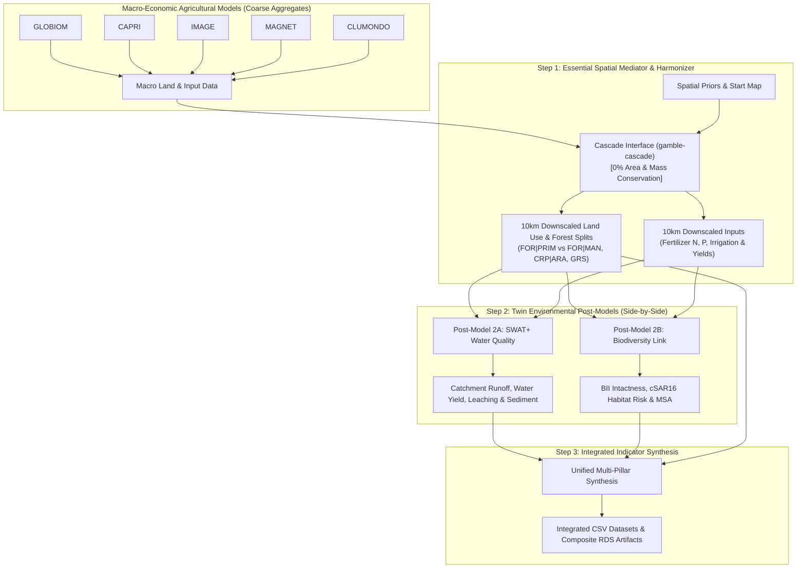

# Act4Cap Integrated Modelling Architecture

The **Act4Cap Integrated Modelling Orchestrator** couples macro-economic agricultural models with spatial downscaling and subsequent environmental post-processors in an automated containerised routine on the WKUBE cluster.

> [!IMPORTANT]
> **Spatial Downscaling as the Necessary Intermediary & Mediator**:  
> Macro-economic models (GLOBIOM, CAPRI, IMAGE, MAGNET, CLUMONDO) operate at coarse national or regional administrative aggregates with no explicit biophysical topology. Conversely, environmental post-processors (**SWAT+** hydrological catchments and **Biodiversity Link** ecoregional habitat networks) strictly require spatially explicit 10km grid-cell geometries, soil/topography interactions, and fine-grained crop management splits.  
> The **Cascade Interface** (`gamble-cascade`) acts as the **indispensable spatial mediator and harmonizer**—translating aggregate policy scenario trajectories into mass-conserved, biophysically grounded 10km allocations that directly enable all downstream environmental post-modelling.



## Architectural Modules

1. **Cascade Interface Downscaling (`downscale`) — The Core Spatial Mediator**:
   - Acts as the indispensable intermediary translating regional/national economic supply balance sheets into spatially explicit 10km EEA EPSG:3035 grid cells.
   - Enforces exact **0% area and mass conservation** across all downscaled land uses and agricultural input volumes.
   - Reconciles heterogeneous macro model classifications into 11–21 harmonized crop and forest management categories (`FOR|MAN`, `FOR|PRIM`, `CRP|ARA|*`, `CRP|PRM|*`, `GRS`, `ONV`, `BUI`).
   - Downscales agricultural input intensities: Total N, Mineral N, Organic N, N balance, Total P, Mineral P, P balance, Pesticides, and Water consumption.
   - **Mediation Role**: Without this step, aggregate macro outputs cannot be ingested by catchment-scale hydrology or pixel-level habitat intactness models.

2. **SWAT+ Water Quality Post-Processor (`swat`)**:
   - Integrates with the European SWAT+ execution toolkit ([`Q:\swatplus_runs`](file:///Q:/swatplus_runs) / `/mnt/wdrv/act4cap/swatplus_runs`), utilizing scripts `0_run_pipeline.py` through `6_run_swatplus.py` and the 146 MB `default_hru_shp/` hydrological units.
   - Translates downscaled land cover and crop fertilizer application into Hydrological Response Units (HRUs).
   - Simulates hydrological water yield (million m³), surface runoff coefficient, soil erosion sediment yield (ktons), and nitrogen/phosphorus leaching (tons) across European river basins.
   - Supports both `tentative` proxy-routing and native cluster simulation (`POSTMODEL_MODE`).
   - Generates cell-level summaries (`swat_plus_cells_<tag>.csv`) and spatially explicit GeoTIFF rasters (`.tif`, EPSG:3035) for annual water yield, surface runoff, $N$-leaching risk, $P$-runoff risk, and sediment yield.

3. **Biodiversity Link Post-Processor (`biodiversity`)**:
   - Implements the IIASA **Biodiversity_Link** methodology ([GitHub commit `6cc4443f24663622cbbae6f22dce5428bce6b50d`](https://github.com/iiasa/Biodiversity_Link/tree/6cc4443f24663622cbbae6f22dce5428bce6b50d)).
   - **Formal AgMIP-to-Biodiversity Mapping**: Uses [`config/mapping_agmip_to_biodiversity_link.csv`](file:///g:/My%20Drive/R/act4cap-orchestrator/config/mapping_agmip_to_biodiversity_link.csv) (configurable via the `BIODIVERSITY_MAPPING_FILE` knob) to provide a rigorous, transparent crosswalk between all downscaled AgMIP land-use classes and IIASA Biodiversity Link categories:
     - `lc_type`: Primary land cover category (`CrpLnd`, `PltFor`, `forest_managed`, `forest_unmanaged`, `Grass`, `OthNatLnd`, `built_area`).
     - `lc_btc`: BTC category (`cropland_other`, `cropland_2Gbioen`, `forest_managed`, `forest_unmanaged_primary`, `grassland`, `other_primary`, `other`, `built.up`).
     - `lc_csar`: Countryside Species-Area Relationship category (`annual_crops`, `permanent_crops`, `intensive_forestry`, `primary`, `pasture`, `urban`).
     - `bii_luclass_f` / `bii_luclass_nf`: Forest vs. non-forest biome coefficients dynamically calibrated against official IIASA `vendor/Biodiversity_Link/Input/BII_coefs.RData`.
     - `msa_default_coef` & `csar_habitat_affinity`: Calibrated indicator weights across agricultural and forest management gradients.
   - Evaluates three complementary ecological integrity metrics:
     - **Biodiversity Intactness Index (BII)**: Calibrated against IIASA `BII_coefs.RData` and `BTC_LC_MAP.RData` across unmanaged primary forest, managed forest, extensive grassland, permanent bioenergy crops, and arable crops.
     - **Countryside Species-Area Relationship (cSAR16)**: Ecoregional extinction risk and habitat intactness index based on transformed vs. natural habitats.
     - **Mean Species Abundance (MSA)**: Landscape-level mean species abundance.
   - Generates cell-level summaries (`biodiversity_link_cells_<tag>.csv`), composite multi-metric RDS artifacts (`mapping_table` embedded), regional tabular summaries, and spatially explicit GeoTIFF rasters (`.tif`, EPSG:3035) for `bii_score`, `csar_intactness`, and `msa_score`.

4. **Multi-Pillar Synthesis (`postprocess` / `all`)**:
   - Merges SWAT+ catchment metrics and Biodiversity Link indicators into a unified multi-pillar indicator CSV dataset: `act4cap_integrated_synthesis_<tag>.csv`.

## Output Storage Format Standard

To balance cross-software human accessibility with big-data performance and disk efficiency:
- **Regional / Policy Aggregates (`.csv`)**:
  - Regional summaries aggregated by NUTS2 / country code (`Ns_reg`) and simulation year (`year`) are stored as standard CSV files (`.csv`).
  - These files are compact (~100–300 rows) and directly openable in spreadsheet applications (Excel, LibreOffice) and business intelligence tools.
  - Examples: `swat_plus_water_quality_summary_<tag>.csv`, `biodiversity_link_bii_summary_<tag>.csv`, `biodiversity_link_csar_summary_<tag>.csv`, `biodiversity_link_msa_summary_<tag>.csv`, and `act4cap_integrated_synthesis_<tag>.csv`.
- **Pixel / Cell-Level Spatial Tables (`.parquet`)**:
  - Cell-level spatial tables containing 10km grid cell identifiers (`ns`), NUTS units, and detailed biophysical/hydrological/ecological indicators strictly enforce the **Apache Parquet standard** (`.parquet`) with Snappy compression via the `arrow` engine.
  - Parquet reduces file sizes by ~80% compared to uncompressed CSVs, preserves strict column datatypes, and accelerates loading into R/Python by ~10x.
  - Examples: `swat_plus_cells_<tag>.parquet`, `biodiversity_link_cells_<tag>.parquet`, and mediated land-use allocations `DS_ACT4CAP_AgMIP_<tag>_lu_<scenario>.parquet`.
- **Spatial Continuous Grids (`.tif`)**:
  - Standard European GeoTIFF rasters (`EPSG:3035`) with LZW compression for direct GIS inspection (QGIS, ArcGIS).
- **In-Memory Bundles (`.rds`)**:
  - Full R composite objects containing tabular summaries, raster paths, and run provenance metadata.
- **Run Manifests (`.json`)**:
  - Self-describing execution metadata and artifact inventories.

## Standardized Output Versioning & File Naming

All output directories, tabular CSVs, RDS composites, and GeoTIFF rasters encode a standardized, reproducible multi-tier version label (`<tag>`):

$$\text{tag} = \langle\text{model}\rangle\_\langle\text{scenario}\rangle\_\langle\text{macro\_output}\rangle\_\langle\text{resolution}\rangle\_\langle\text{date}\rangle[\_\langle\text{custom\_tag}\rangle][\_\text{TRIAL}]$$

### Label Components:
1. **Macro Model & Scenario**: Identifies the economic driver (e.g. `globiom_base`, `capri_ndc`).
2. **Macro Model Output Name**: Stem of the source macro vintage (e.g. `20260916_compr_scens_merge` or `AgMIP_GLOBIOM_20261001`).
3. **Downscale Resolution**: Spatial resolution of the simulation units (e.g. `10km`, `5km`, `2km`).
4. **Date Stamp**: Execution date in `YYYYMMDD` format (configurable via `RUN_DATE`, defaults to current date).
5. **Custom Version Tag**: Optional user identifier appended via `VERSION_TAG` (e.g. `v1`, `deliv3`).
6. **Trial Mode Indicator**: Appended as `_TRIAL` whenever `TRIAL=1` or `TASK=trial` is active.

### Unified Job Directory Structure

All analytical outputs for a given run are unified into a self-contained, reproducible job folder (`outputs/<tag>/`), supplemented by a top-level synthesis index:

```
outputs/
├── <tag>/                                                 # e.g. globiom_base_20260916_compr_scens_merge_10km_20261103
│   ├── manifest.json                                      # Run metadata, parameters & artifact inventory
│   │
│   ├── synthesis/                                         # Unified cross-pillar outputs
│   │   └── act4cap_integrated_synthesis_<tag>.csv
│   │
│   ├── water_quality/                                     # SWAT+ hydrological and nutrient outputs
│   │   ├── swat_plus_water_quality_summary_<tag>.csv      # Regional NUTS summary (.csv)
│   │   ├── swat_plus_cells_<tag>.parquet                  # 10km grid cell metrics (.parquet)
│   │   ├── swat_plus_composite_<tag>.rds
│   │   └── rasters/                                       # Spatially explicit GeoTIFFs (EPSG:3035)
│   │       ├── swat_<tag>_n_leach_kg_ha_<year>.tif
│   │       ├── swat_<tag>_p_runoff_kg_ha_<year>.tif
│   │       ├── swat_<tag>_sediment_t_ha_<year>.tif
│   │       └── swat_<tag>_water_yield_mm_<year>.tif
│   │
│   ├── biodiversity/                                      # Biodiversity Link ecological outputs
│   │   ├── biodiversity_link_bii_summary_<tag>.csv        # Regional BII summary (.csv)
│   │   ├── biodiversity_link_csar_summary_<tag>.csv       # Regional cSAR summary (.csv)
│   │   ├── biodiversity_link_msa_summary_<tag>.csv        # Regional MSA summary (.csv)
│   │   ├── biodiversity_link_cells_<tag>.parquet          # 10km grid cell metrics (.parquet)
│   │   ├── biodiversity_link_composite_<tag>.rds
│   │   └── rasters/                                       # Spatially explicit GeoTIFFs (EPSG:3035)
│   │       ├── biodiversity_<tag>_bii_score_<year>.tif
│   │       ├── biodiversity_<tag>_csar_intactness_<year>.tif
│   │       └── biodiversity_<tag>_msa_score_<year>.tif
│   │
│   └── downscaling/                                       # Mediated 10km AgMIP land use & allocation
│       └── DS_ACT4CAP_AgMIP_<tag>_lu_<scenario>.parquet   # 10km land use (.parquet)
│
└── synthesis/                                             # Central index of all scenario syntheses
    └── act4cap_integrated_synthesis_<tag>.csv

## Accelerator Drive & Cluster Mount Parity

The orchestrator seamlessly handles cross-platform storage paths between Linux cluster deployments (`/mnt/wdrv/act4cap`) and Windows workstation environments (`W:\act4cap`):
- **Windows Auto-Mapping**: When running on Windows and `WORK_DIR` points to `/mnt/wdrv/act4cap`, the orchestrator transparently maps paths to `W:\act4cap`, writing outputs and accessing shared inputs without path friction.
- **Pre-computed Macro Model Downscalings**: Located directly in `W:\cascade_gamble_outputs\` (`DS_ACT4CAP_AgMIP_<MODEL>_10km_*_lu_<scenario>.csv`) across CAPRI, CLUMONDO, GLOBIOM, IMAGE, and MAGNET.
- **Shared SWAT+ & Biodiversity Assets**: Located under `W:\swatplus_runs\` and `W:\enriched_with_bii\`.

## Input File & Vintage Resolution

The routine accepts macro-model inputs with flexible vintage selection via the `INPUT_FILE` knob:
- **Explicit Filename/Path**: Specify an exact input file (e.g. `20260428_compr_scens_merge_MAGNET_CluMondo_IMAGE_GLOBIOM_CAPRI.csv` or a custom dataset). The orchestrator locates it either by absolute path or searches candidate input directories.
- **Auto-Detected Latest Vintage**: If `INPUT_FILE` is left empty or set to `"latest"`, the orchestrator inspects the macro model directories (`INPUT_DIR`, `P:/globiom/Projects/DS_AgMIP/AgMIP_output`, etc.), parses date prefixes (`YYYYMMDD`) and file modification times (`mtime`), and automatically selects the most recent vintage (e.g. `20260916_compr_scens_merge.csv`).

## Step Output Auto-Resolution & Incremental Resumption

The orchestrator enforces automatic incremental caching across all workflow stages via the `FORCE` knob:
- **Default (`FORCE=0` / Resume mode)**:
  - **Step 1 (Downscaling)**: Automatically checks if downscaled 10km land-use maps already exist for the `(model, scenario)` pair. If found, reuses them immediately and skips re-running downscaling.
  - **Step 2A (SWAT+)**: Automatically checks if versioned summary CSV exists. If found, reuses it immediately and skips hydrological catchment re-simulation.
  - **Step 2B (Biodiversity Link)**: Automatically checks if versioned BII, cSAR, and MSA summaries exist. If found, reuses them immediately and skips ecological metric re-evaluation.
  - **Step 3 (Synthesis)**: If the final multi-pillar synthesis CSV exists and neither upstream submodel was freshly recomputed, reuses the existing synthesis dataset.
- **Forced Re-computation (`FORCE=1` / Overwrite mode)**:
  - Bypasses cached outputs and forces end-to-end execution, overwriting all artifacts on disk.
