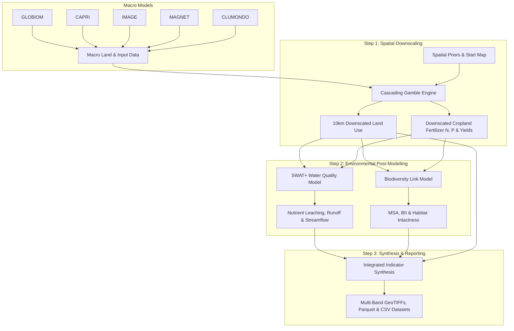

# Act4Cap Integrated Modelling Architecture

The **Act4Cap Integrated Modelling Orchestrator** couples macro-economic agricultural models with spatial downscaling and subsequent environmental post-processors in an automated containerised routine on the WKUBE cluster.

## Post-Modelling Modules

1. **Cascading Gamble Downscaling (`downscale`)**:
   - Allocates national macro targets to 10km grid cells with exact 0% area and mass conservation.
   - Downscales 11-21 specific crop and management classes (`FOR|MAN`, `FOR|PRIM`, `CRP|ARA|*`, `CRP|PRM|*`).
   - Allocates agricultural inputs: Total N, Mineral N, Organic N, N balance, Total P, Mineral P, P balance, Pesticides, and Water consumption.

2. **SWAT+ Water Quality (`swat`)**:
   - Translates downscaled land cover and crop fertilizer application into Hydrological Response Units (HRUs).
   - Simulates hydrological water yield, surface runoff, soil erosion, and nitrogen/phosphorus leaching across European river basins.

3. **Biodiversity Link (`biodiversity`)**:
   - Translates spatial land use, forest management split (`FOR|PRIM` vs `FOR|MAN`), and agrochemical pressures into Mean Species Abundance (MSA) and Biodiversity Intactness Index (BII).
   - Assesses landscape fragmentation and habitat suitability.
